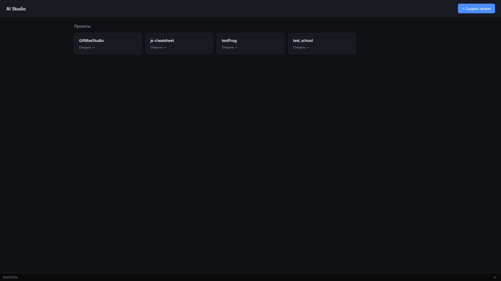
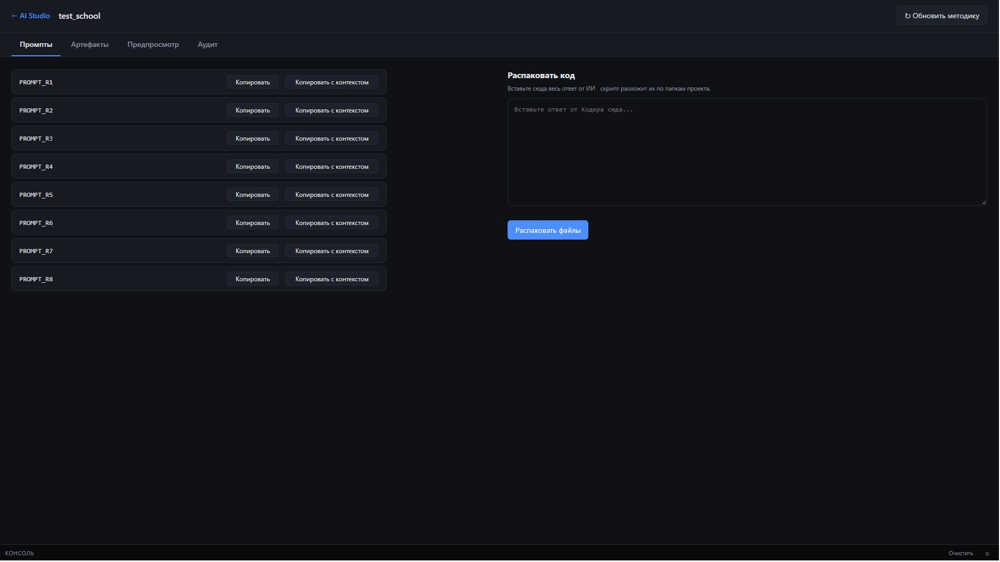
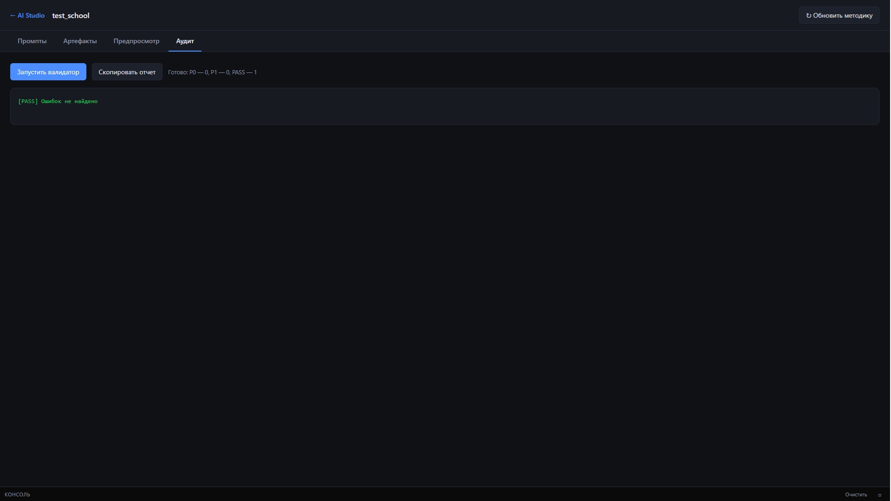
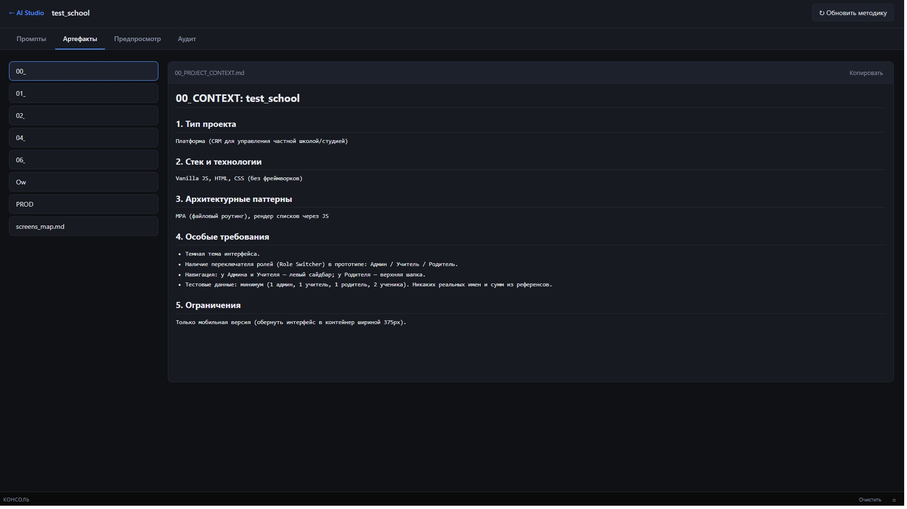
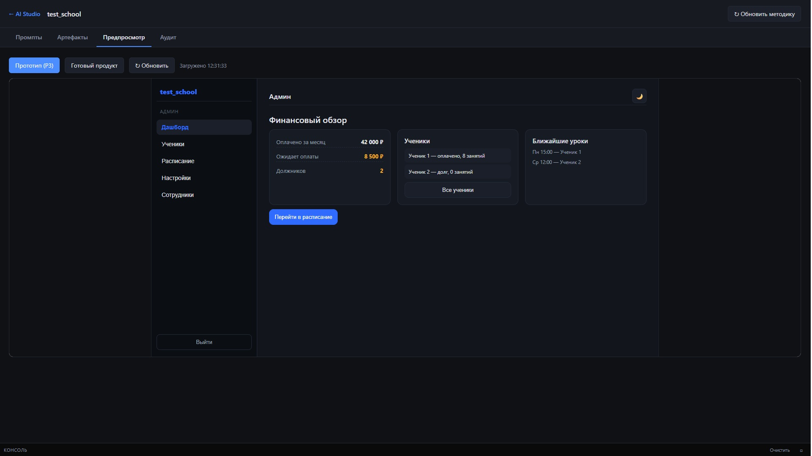
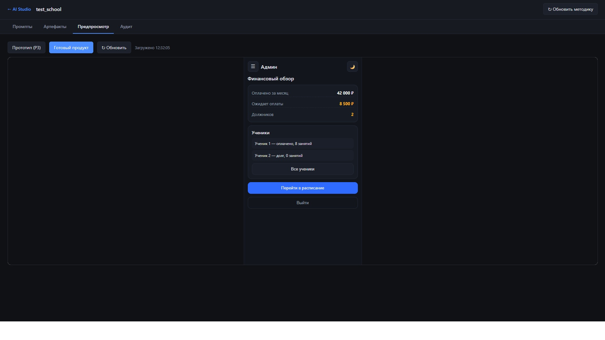

# AI Studio: Среда для управления разработкой с ИИ

**AI Studio** — это веб-интерфейс (дашборд), созданный для управления процессом разработки программных продуктов с использованием ИИ-агентов. Вместо того чтобы держать десятки вкладок в браузере и терять контекст, все проекты, артефакты и инструменты проверки собраны в одном месте.

## 🚀 Ключевые возможности

### 1. Управление проектами
Единая точка входа (Дашборд), где отображаются все текущие разработки: от готовых онлайн-продуктов (`js-cheatsheet`) до тестовых MVP (`test_school`, `GiftBoxStudio`).

### 2. Сборка контекста для ИИ
На вкладке «Промпты» реализован интерфейс для работы с 8 ролями ИИ-агентов. Кнопка **«Копировать с контекстом»** автоматически собирает нужные файлы проекта (ТЗ, схемы, код) в один текст для передачи нейросети.

### 3. Автоматическая распаковка
Интерфейс позволяет вставить ответ от ИИ (сгенерированный код) и автоматически разложить его по правильным папкам проекта (HTML, CSS, JS). Система сама очищает Markdown-обертки и защищает от записи за пределы папки проекта.

### 4. Встроенный валидатор
Вкладка «Аудит» позволяет запускать проверку кода (ESLint, HTMLHint, Stylelint) прямо из интерфейса. Система наглядно показывает статус: `PASS` (ошибок нет) или список критических ошибок (P0/P1).

### 5. Работа с документацией
Вкладка «Артефакты» умеет рендерить Markdown-файлы (ТЗ, схемы, бэклоги) в красивый читаемый вид с таблицами и заголовками.

### 6. Живой предпросмотр
Встроенный iframe позволяет переключаться между прототипом (Mobile) и готовым продуктом (Desktop) прямо в окне студии.

## 🎯 Задача, которую решает проект

Систематизировать хаос при работе с генеративным ИИ. AI Studio выступает как «пульт управления»: он берет на себя рутину по копированию файлов, сбору контекста, проверке кода и визуализации документов, позволяя разработчику сосредоточиться на архитектуре и логике продукта.

## 🛠️ Технологии (визуальная и серверная часть)

- **Frontend:** Vanilla JS (ES6+), HTML5, CSS3.
- **Backend:** Node.js (Express), `child_process` для запуска валидаторов.
- **Инструменты:** ESLint, HTMLHint, Stylelint.

